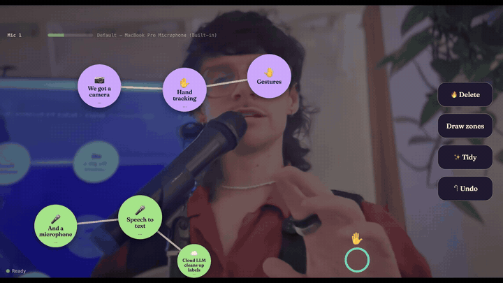

# Natter

Brainstorm with your hands and your voice. People stand in front of a screen of idea bubbles; the camera reads their hands and body, and what they say becomes ideas on the board.



Shown at AI Tinkerers London in November 2026. The [write-up](https://simonwisdom.com/posts/natter/) has more clips from the demo.

## Why

Most of the time we use computers hunched over a small screen, typing. When people talk in a room they move, point and gesture, and most of that is lost at a keyboard. Natter is a prototype for working with your whole body: the feel of brainstorming at a whiteboard together, with what an LLM can add.

It is built to be fast. Waiting even ten seconds breaks the flow of an idea, so it uses small models running on the Mac where it can: hand tracking in the browser and speech to text on device.

## What it does

Body Lab puts a board of idea bubbles on the screen with your hands drawn over it. Close a fist to pick a bubble up, say an idea to make a new one, point at a bubble to branch from it, and make a victory sign to have the LLM suggest two more. Up to two people can talk at once, one microphone each. Speech is transcribed on your Mac; an LLM words the ideas, hosted or running on your Mac.

| Do this | What happens |
|---|---|
| Close a fist on a bubble | Picks it up; open your hand to drop it |
| Drop a bubble onto another | They merge, and the LLM names the combined idea |
| Fist on empty space, then say an idea | A new idea, held until you open your hand |
| Point at a bubble, pull away, say an idea | A new branch from that bubble |
| Victory sign on a bubble | The LLM adds two ideas of its own |
| Both fists on empty space, pushed together | Zoom out to the overview of the whole canvas |
| Both hands raised, say how to organise | The LLM sorts the bubbles into axes or zones |
| Thumbs up or down on a bubble | Star it or bin it |

Press **?** in the app to see every keyboard shortcut. You can also use the mouse and keyboard in place of your hands.

## Still rough

- Saying how to organise the board (both hands raised) doesn't always start.
- Two people at once (four hands, two microphones) is the least reliable part.
- Hands can block the screen, and a gesture can be read as one you didn't mean.

Ideas for later: brainstorming together from different rooms, more than one camera, and glasses in place of a big screen.

## What you need

- A Mac with Apple silicon
- Chrome, with camera and microphone allowed
- Node 24 and [uv](https://docs.astral.sh/uv/)
- An LLM, one of:
  - **Local:** [Ollama](https://ollama.com) with `qwen3:8b` (`ollama pull qwen3:8b`). Put `NATTER_LLM=local` in `.env` and nothing leaves your Mac.
  - **Hosted:** a Claude Code login (used by default, no key needed) or an Anthropic API key in `.env`. If Ollama is running, its model stands in while the hosted one is slow or down.

## Run it

```bash
./run.sh
```

Then open <http://127.0.0.1:8777/lab.html> in Chrome and allow the camera and microphone.

The first start downloads the Parakeet speech model (about 2.3 GB). The web build downloads the MediaPipe models, and the page loads the Fraunces and Caveat fonts from Google Fonts.

More about running and changing it is in [DEVELOPING.md](DEVELOPING.md).

## Credits

- [MediaPipe](https://ai.google.dev/edge/mediapipe) tasks-vision, with its pose landmarker and gesture recognizer models (Apache-2.0)
- [Parakeet TDT 0.6B v3](https://huggingface.co/nvidia/parakeet-tdt-0.6b-v3) by NVIDIA (CC-BY-4.0), run with [parakeet-mlx](https://github.com/senstella/parakeet-mlx) (Apache-2.0) on [MLX](https://github.com/ml-explore/mlx) (MIT)
- [Ollama](https://ollama.com) and [Qwen3](https://github.com/QwenLM/Qwen3) for the local model; [Claude](https://www.anthropic.com/claude) through the Claude Agent SDK for the hosted one
- [Fraunces](https://fonts.google.com/specimen/Fraunces) and [Caveat](https://fonts.google.com/specimen/Caveat) (SIL Open Font License)
- [Vite](https://vite.dev), [zod](https://zod.dev), [FastAPI](https://fastapi.tiangolo.com) (MIT)

## License

MIT, see [LICENSE](LICENSE).
